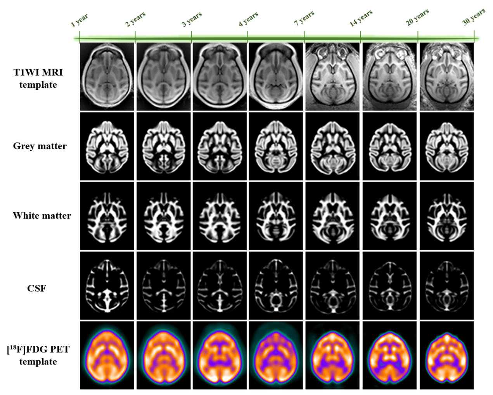
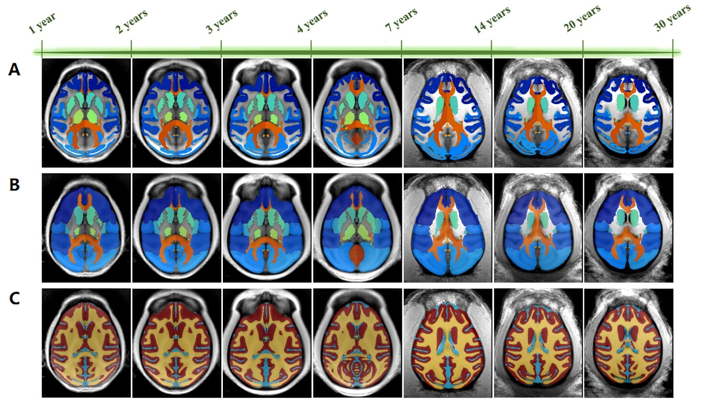

# Lifespan Cynomolgus Monkey PET–MRI Brain Templates and Atlases

This repository provides a full-spectrum, age-stage-specific stereotaxic brain
template and atlas set for cynomolgus monkeys (*Macaca fascicularis*) across
the lifespan. Seven development and aging stages are defined as : G01 (1 year old), G02 (2 years old), G03 (3 years old), G04 (4-6 years old), G05 (7-13 years old), G06 (14-20 years old), and G07 (> 20 years old). The resource combines
T1-weighted MRI structural templates, population tissue probability maps
(TPMs), [<sup>18</sup>F]FDG PET templates, and multi-scale brain atlases in a
common stereotaxic space.

The dataset is intended to support harmonized structural MRI analysis, PET
radiotracer quantification, metabolic network construction, connectivity
analysis, and MRI-free partial-volume-effect correction across the lifespan.

## Overview

The template set contains:

- T1-weighted MRI structural brain templates at
  **0.25 × 0.25 × 0.25 mm³** resolution.
- Population intracranial TPMs for gray matter (GM), white matter (WM), and
  cerebrospinal fluid (CSF), at **0.25 × 0.25 × 0.25 mm³** resolution.
- [<sup>18</sup>F]FDG PET functional brain templates at
  **1 × 1 × 1 mm³** resolution.
- Three complementary atlas types across seven consecutive age stages.
- Spreadsheet lookup tables describing the atlas labels.

All modalities within an age stage share a common coordinate space.

## Template set



**Figure 1. Lifespan-wide age-stage-specific brain templates and TPMs in
cynomolgus monkeys.** Axial views of the T1-weighted MRI structural templates
(row 1), TPMs for GM, WM, and CSF (rows 2–4, grayscale), and
[<sup>18</sup>F]FDG PET templates (row 5, pseudocolor) are shown for the seven
stages bounded by the displayed ages. Each template represents the interval
between two adjacent age boundaries. All modalities share a unified coordinate
space.

## Multi-scale atlases



**Figure 2. Lifespan-wide multi-scale brain atlases for cynomolgus monkeys.**
Axial overlays of the age-stage-specific atlases on their corresponding
T1-weighted templates. Each atlas represents the interval between two adjacent
age boundaries: **(A)** functional parcellation atlas, **(B)** macrostructural
atlas, and **(C)** tri-tissue label atlas.

The atlas set includes:

1. **Functional parcellation atlas**

   Separates the brain into 90 left–right paired sub-anatomical regions for
   metabolic network construction and fine-grained connectivity analysis.

2. **Macrostructural atlas**

   Supports reference-region definition in quantitative PET workflows and
   extraction of time–activity curves (TACs) from dynamic PET studies.

3. **Tri-tissue atlas**

   Labels GM, WM, and CSF and can serve as the input for MRI-free
   partial-volume-effect (PVE) correction label maps.

## Repository contents

Files prefixed with `G01` through `G07` correspond to seven consecutive
lifespan stages. Each stage is bounded by two adjacent age points shown in the
figures.

| Group | Corresponding age stage |
| --- | --- |
| `G01` | 1–2 years |
| `G02` | 2–3 years |
| `G03` | 3–4 years |
| `G04` | 4–7 years |
| `G05` | 7–14 years |
| `G06` | 14–20 years |
| `G07` | >20 years |

| File pattern | Description |
| --- | --- |
| `G##_template.nii` | T1-weighted MRI structural template |
| `G##_TPM_new.nii` | Population GM, WM, and CSF tissue probability maps |
| `G##_PET_template_final_resliced.nii` | Resliced [<sup>18</sup>F]FDG PET template |
| `G##_Cynomolgus_atlas_function.nii` | Functional parcellation atlas |
| `G##_Cynomolgus_atlas_Whole.nii` | Tri-tissue label atlas |
| `G##_Cynomolgus_atlas_MicroStructural.nii` | Macrostructural whole-brain atlas |
| `Cynomolgus_atlas_*.xls` | Atlas label lookup tables |
| `assets/` | Figures used in this README |
| `docs/project-description.docx` | Original project description |

Some modalities are not present for every age stage in the current release.
See the repository file list for the available combinations.

## File formats

- **NIfTI (`.nii`)** files contain the volumetric templates, TPMs, and atlases.
- **Excel 97–2003 (`.xls`)** files contain atlas label definitions.

The NIfTI files can be opened with software such as
[FSLeyes](https://fsl.fmrib.ox.ac.uk/fsl/docs/#/utilities/fsleyes),
[ITK-SNAP](http://www.itksnap.org/), or
[MRIcroGL](https://www.nitrc.org/projects/mricrogl).

## Downloading the data

The large NIfTI files are managed with
[Git Large File Storage](https://git-lfs.com/). Install Git LFS before cloning:

```bash
git lfs install
git clone https://github.com/Rose-0616/cynomolgus-lifespan-pet-mri-atlas.git
cd cynomolgus-lifespan-pet-mri-atlas
git lfs pull
```

## Citation

If you use this resource, please cite the associated publication. The full
citation and DOI will be added when available.

## License

No reuse license has yet been specified for this dataset. Until a license is
added, please contact the authors before redistributing or reusing the data.

## Contact

Questions, corrections, and requests for additional information may be
submitted through the repository's GitHub Issues page.
